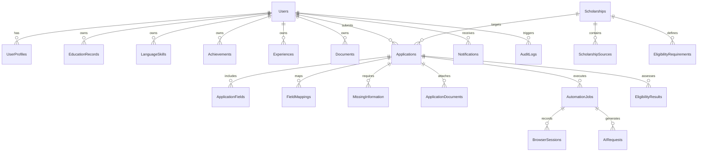

# Scholaris — Technical Architecture Document

**System Name:** Scholaris (Intelligent Scholarship Verification & Application Assistant)  
**Architecture Style:** Modular Monorepo (pnpm workspaces)  
**Primary Language:** TypeScript (Node.js & Browser) with optional Python for specialized OCR  
**Version:** 1.0  
**Status:** Approved Technical Design

---

## 1. Technology Stack & Responsibilities

| Tier / Component | Technology | Primary Responsibility |
| :--- | :--- | :--- |
| **Frontend Web App** | Next.js 15+ (App Router), React 19, TypeScript | User dashboard, student profile, scholarship management, review & approval UI, responsive UX |
| **Frontend Styling & UI** | Tailwind CSS v4, shadcn/ui, Lucide Icons | Accessible, high-craft, non-generic UI system adhering to `docs/DESIGN_SYSTEM.md` |
| **Frontend State & Data** | TanStack Query v5, React Hook Form, Zod | Server-state caching, form validation, optimistic updates, real-time polling/SSE |
| **Backend API** | Fastify v5, TypeScript | REST API (`/api/v1`), auth, route plugins, job dispatching, business logic, validation |
| **Database & ORM** | PostgreSQL 16+, Prisma ORM | Relational data persistence, schema migrations, type-safe queries, relational integrity |
| **Job Queue & Cache** | Redis 7+, BullMQ | Background job orchestration (browser automation, AI tasks, document parsing) |
| **Browser Automation** | Playwright (Chromium) | Headless/headed browser sessions, form DOM analysis, automated input filling, human login handoff |
| **Document Processing** | TypeScript (pdf-parse/pdfjs) + Python worker (PyMuPDF, Tesseract OCR) | Text extraction, OCR for scanned PDFs/images, metadata extraction |
| **File Storage** | S3-Compatible Object Storage (MinIO locally / AWS S3 or Cloudflare R2 in prod) | Encrypted storage for student transcripts, identity documents, and resumes |
| **AI Orchestration** | Custom `packages/ai` service | Google Gemini 2.5/Pro (primary) & OpenRouter (fallback), structured JSON outputs |
| **Package Manager** | pnpm (monorepo workspaces) | Fast, deterministic dependency management, shared packages |

---

## 2. Monorepo Project Structure

```
scholaris/
├── apps/
│   ├── web/                         # Next.js Frontend Application
│   │   ├── app/                     # Next.js App Router (pages & layouts)
│   │   │   ├── (auth)/              # Login, register, forgot-password
│   │   │   ├── (dashboard)/         # Student dashboard, profile, scholarships, applications
│   │   │   ├── (admin)/             # Admin monitoring and settings
│   │   │   └── api/                 # Next.js edge/proxy routes if needed
│   │   ├── components/              # Reusable UI components (shadcn + custom)
│   │   │   ├── ui/                  # Atomic shadcn primitives (button, dialog, input...)
│   │   │   ├── layout/              # Header, sidebar, shell, footer
│   │   │   └── modules/             # Profile forms, verification cards, review modal
│   │   ├── hooks/                   # Custom React hooks (useAuth, useApplicationProgress)
│   │   ├── lib/                     # Client utilities (api client, formatters)
│   │   └── types/                   # Frontend-specific types
│   │
│   ├── api/                         # Fastify Backend REST API
│   │   ├── src/
│   │   │   ├── config/              # Environment config, constants, security settings
│   │   │   ├── middleware/          # Auth guards, rate limiting, error handlers
│   │   │   ├── plugins/             # Fastify plugins (cors, jwt, swagger, prisma)
│   │   │   ├── modules/             # Domain modules (routes, controllers, services)
│   │   │   │   ├── auth/            # Registration, login, session, password reset
│   │   │   │   ├── users/           # User management
│   │   │   │   ├── profiles/        # Personal, family, language, achievements
│   │   │   │   ├── education/       # High school, university, postgraduate records
│   │   │   │   ├── documents/       # Uploads, metadata, S3 presigned URLs
│   │   │   │   ├── scholarships/    # URL ingestion, listing, detail
│   │   │   │   ├── verification/    # Domain & institution authenticity verification
│   │   │   │   ├── eligibility/     # AI eligibility matching & scoring
│   │   │   │   ├── applications/    # Application preparation, field mapping, review & approval
│   │   │   │   ├── automation/      # Browser job triggers & session coordination
│   │   │   │   ├── ai/              # AI controller & prompt execution
│   │   │   │   ├── notifications/   # In-app alerts and notifications
│   │   │   │   └── admin/           # Platform metrics & audit logs
│   │   │   └── server.ts            # Fastify application entry point
│   │
│   ├── browser-worker/              # Dedicated Playwright Worker Service
│   │   ├── src/
│   │   │   ├── browser/             # Chromium lifecycle, proxy & context management
│   │   │   ├── navigation/          # URL loader, redirect tracer, wait-for-ready
│   │   │   ├── form-detection/      # DOM analyzer, field classification, label matching
│   │   │   ├── field-filling/       # Text typing, dropdown selection, file upload
│   │   │   ├── sessions/            # Interactive user handoff for login / CAPTCHA
│   │   │   └── jobs/                # BullMQ worker handlers (verify-url, fill-form, submit)
│   │   └── index.ts                 # Worker entrypoint
│   │
│   └── document-worker/             # Optional Python OCR & Document Extraction Service
│       ├── src/
│       │   ├── extraction/          # PyMuPDF & docx text extractors
│       │   ├── ocr/                 # Tesseract OCR pipeline for scanned records
│       │   └── worker.py            # Redis queue listener or FastAPI microservice
│       └── requirements.txt
│
├── packages/
│   ├── database/                    # Prisma ORM & Database Client
│   │   ├── prisma/
│   │   │   ├── schema.prisma        # Complete PostgreSQL relational schema
│   │   │   └── migrations/          # Version-controlled migrations
│   │   └── src/index.ts             # Exported PrismaClient instance & helpers
│   │
│   ├── shared/                      # Shared business constants, utility functions
│   │   └── src/index.ts
│   │
│   ├── types/                       # Shared TypeScript interfaces & DTOs
│   │   └── src/index.ts
│   │
│   ├── validation/                  # Shared Zod validation schemas (isomorphic)
│   │   └── src/index.ts
│   │
│   ├── ai/                          # Multi-Provider AI Service
│   │   ├── src/
│   │   │   ├── providers/
│   │   │   │   ├── gemini.ts        # Google Gemini implementation
│   │   │   │   └── openrouter.ts    # OpenRouter implementation
│   │   │   ├── model-selector.ts    # Cost, quota & latency dynamic router
│   │   │   ├── fallback.ts          # Automatic graceful fallback handling
│   │   │   ├── schemas/             # Structured JSON response schemas
│   │   │   └── ai-service.ts        # Unified public interface
│   │
│   └── queue/                       # Shared BullMQ queue definitions & Redis connection
│       └── src/index.ts
│
├── infrastructure/                  # Deployment & Local Dev Config
│   ├── docker/
│   │   ├── Dockerfile.api
│   │   ├── Dockerfile.web
│   │   └── Dockerfile.browser
│   ├── minio/                       # MinIO local storage setup
│   └── scripts/                     # Seed scripts, health checks, backup utils
│
├── docs/                            # Project Documentation
│   ├── ASCAF_spec.md                # Original specification
│   ├── PROJECT.md                   # Requirements specification
│   ├── ARCHITECTURE.md              # Technical architecture
│   ├── TASKS.md                     # Development roadmap
│   ├── PROGRESS.md                  # Development progress log
│   └── DESIGN_SYSTEM.md             # Visual design tokens and UI standards
│
├── docker-compose.yml               # Local stack (Postgres, Redis, MinIO)
├── package.json                     # Monorepo root configuration
├── pnpm-workspace.yaml              # pnpm workspaces definition
└── tsconfig.base.json               # Shared TypeScript compiler configuration
```

---

## 3. Database Architecture & Relationships

PostgreSQL with Prisma ORM handles structured, relational data integrity.

### 3.1 Core Entity Schema Summary



### 3.2 Detailed Entity Definitions

1. **Users**: Core authentication entity (`id: UUID`, `email: String`, `passwordHash: String`, `role: Role [STUDENT, ADMIN]`, `isEmailVerified: Boolean`, `createdAt`, `updatedAt`).
2. **UserProfiles**: Detailed personal information (`id`, `userId`, `firstName`, `middleName`, `lastName`, `fullName`, `dateOfBirth`, `gender`, `nationality`, `residenceCountry`, `city`, `address`, `phone`, `altEmail`, `passportNumberEncrypted`, `familyIncomeTier`, `financialStatement`).
3. **EducationRecords**: Multi-tier education (`id`, `userId`, `level: [HIGH_SCHOOL, UNDERGRADUATE, POSTGRADUATE, DOCTORAL]`, `institution`, `faculty`, `degree`, `fieldOfStudy`, `startDate`, `endDate`, `gpa`, `maxGpa`, `honors`).
4. **LanguageSkills**: Language proficiency records (`id`, `userId`, `language`, `isNative`, `proficiencyLevel`, `testType: [IELTS, TOEFL, DUOLINGO, NONE]`, `testScore`, `testDate`).
5. **Achievements**: Awards, honors, certifications, publications (`id`, `userId`, `title`, `issuer`, `dateReceived`, `description`).
6. **Experiences**: Work, volunteer, and research history (`id`, `userId`, `type: [WORK, VOLUNTEER, RESEARCH]`, `organization`, `roleTitle`, `startDate`, `endDate`, `description`).
7. **Documents**: Secure document repository (`id`, `userId`, `name`, `category: [TRANSCRIPT, CV, PASSPORT, RECOMMENDATION, ESSAY, CERTIFICATE]`, `fileUrl`, `fileKey`, `mimeType`, `sizeBytes`, `extractedText`, `ocrStatus: [PENDING, COMPLETED, FAILED]`, `checksum`).
8. **Scholarships**: Evaluated scholarship opportunities (`id`, `title`, `providerName`, `websiteUrl`, `applicationUrl`, `deadline`, `fundingType: [FULL, PARTIAL, TUITION_ONLY]`, `verificationStatus: [PENDING, VERIFIED, UNCERTAIN, SUSPICIOUS]`, `verificationScore: Float`, `verificationSummary: Text`).
9. **ScholarshipSources**: Independent verification citations (`id`, `scholarshipId`, `sourceUrl`, `sourceDomain`, `institutionMatch: Boolean`, `scamFlagsDetected: Json`, `evidenceNotes: Text`).
10. **EligibilityRequirements**: Parsed requirements (`id`, `scholarshipId`, `category: [NATIONALITY, AGE, GPA, DEGREE_LEVEL, LANGUAGE, FIELD]`, `operator: [EQ, GTE, LTE, IN]`, `requiredValue: String`, `isMandatory: Boolean`).
11. **EligibilityResults**: User-to-scholarship eligibility evaluation (`id`, `userId`, `scholarshipId`, `status: [ELIGIBLE, INELIGIBLE, INSUFFICIENT_INFO]`, `score: Float`, `criteriaBreakdown: Json`).
12. **Applications**: Application workflow instances (`id`, `userId`, `scholarshipId`, `status: [DRAFT, PREPARING, WAITING_FOR_INPUT, READY_FOR_REVIEW, AWAITING_APPROVAL, SUBMITTING, SUBMITTED, FAILED, REQUIRES_MANUAL_ACTION]`, `userApprovedAt: DateTime`, `submittedAt: DateTime`, `submissionProofUrl: String`, `notes: Text`).
13. **ApplicationFields**: Discovered form inputs (`id`, `applicationId`, `fieldKey`, `label`, `fieldType: [TEXT, TEXTAREA, SELECT, RADIO, CHECKBOX, FILE]`, `options: Json`, `isRequired: Boolean`, `pageNumber: Int`).
14. **FieldMappings**: AI mapping from profile to form (`id`, `applicationId`, `fieldId`, `mappedValue: Text`, `sourceType: [PROFILE, DOCUMENT, USER_INPUT, AI_DRAFT]`, `sourcePath: String`, `confidence: Float`, `isEditedByUser: Boolean`).
15. **MissingInformation**: Gaps that require user input (`id`, `applicationId`, `fieldId`, `prompt`, `category: [FIELD_VALUE, DOCUMENT_UPLOAD, ESSAY_RESPONSE]`, `isResolved: Boolean`, `userResponse: Text`).
16. **ApplicationDocuments**: Attached documents for specific applications (`id`, `applicationId`, `documentId`, `targetFieldKey: String`).
17. **BrowserSessions**: Browser automation traces (`id`, `applicationId`, `workerId`, `sessionStatus: [INITIALIZING, RUNNING, PAUSED_FOR_USER, COMPLETED, ERROR]`, `lastScreenshotUrl: String`, `errorMessage: Text`).
18. **AutomationJobs**: Queue task records (`id`, `applicationId`, `type: [VERIFY_URL, EXTRACT_FORM, FILL_FORM, SUBMIT_APPLICATION]`, `bullJobId: String`, `status: [QUEUED, ACTIVE, COMPLETED, FAILED]`, `attempts: Int`, `errorLog: Text`).
19. **AIRequests**: Auditing AI queries & token consumption (`id`, `userId`, `provider: [GEMINI, OPENROUTER]`, `model: String`, `taskType: [VERIFICATION, ELIGIBILITY, MATCHING, ESSAY_DRAFT]`, `promptTokens: Int`, `completionTokens: Int`, `costEstimate: Float`, `latencyMs: Int`, `status: [SUCCESS, FALLBACK, FAILED]`).
20. **Notifications**: In-app user notifications (`id`, `userId`, `title`, `message`, `type: [INFO, WARNING, ACTION_REQUIRED, SUCCESS]`, `isRead: Boolean`, `linkUrl: String`).
21. **AuditLogs**: Immutable security records (`id`, `userId`, `action: String`, `entityType: String`, `entityId: String`, `ipAddress: String`, `userAgent: String`, `timestamp: DateTime`).

---

## 4. API Architecture & Communication

All backend endpoints are scoped under `/api/v1` and organized into Fastify route plugins.

### 4.1 Authentication & Profile Endpoints
- `POST /api/v1/auth/register` — Create user account
- `POST /api/v1/auth/login` — Authenticate and issue session tokens
- `POST /api/v1/auth/logout` — Revoke session token
- `POST /api/v1/auth/refresh` — Refresh expired access token
- `POST /api/v1/auth/forgot-password` / `POST /api/v1/auth/reset-password`
- `GET /api/v1/profile` & `PUT /api/v1/profile` — Profile CRUD
- `GET/POST/PUT/DELETE /api/v1/profile/education` — Education records
- `GET/POST/PUT/DELETE /api/v1/profile/languages` — Language records
- `GET/POST/PUT/DELETE /api/v1/profile/achievements` & `experiences`

### 4.2 Documents Endpoints
- `GET /api/v1/documents` — List user documents
- `POST /api/v1/documents/presigned-upload` — Obtain S3 presigned upload URL
- `POST /api/v1/documents/confirm-upload` — Confirm upload and queue extraction
- `GET /api/v1/documents/:id/download` — Presigned secure download URL
- `DELETE /api/v1/documents/:id` — Delete document

### 4.3 Scholarships & Verification Endpoints
- `POST /api/v1/scholarships/analyze` — Submit URL for inspection and queue verification job
- `GET /api/v1/scholarships` & `GET /api/v1/scholarships/:id` — Details & authenticity report
- `POST /api/v1/scholarships/:id/check-eligibility` — Trigger AI eligibility evaluation

### 4.4 Applications & Automation Endpoints
- `POST /api/v1/applications` — Initialize application workflow
- `GET /api/v1/applications/:id` — Fetch complete application status & field mappings
- `POST /api/v1/applications/:id/prepare` — Trigger browser form extraction & AI mapping
- `GET /api/v1/applications/:id/missing-info` — Retrieve missing questions
- `PUT /api/v1/applications/:id/missing-info` — Submit missing answers / select documents
- `PUT /api/v1/applications/:id/fields` — Edit pre-filled field mappings before submission
- `POST /api/v1/applications/:id/draft-essay` — Request AI draft for a personal statement
- **`POST /api/v1/applications/:id/approve`** — **Explicit user authorization gate**
- `POST /api/v1/applications/:id/submit` — Trigger browser worker execution of approved submission
- `GET /api/v1/automation/sessions/:id/stream` — SSE stream of browser worker status & live screenshots

---

## 5. Security & Isolation Architecture

1. **User Data Isolation**:
   - Every database query strictly scopes rows by `userId` derived from the verified JWT.
   - Cross-tenant data leakage is prevented at both the service layer and Prisma middleware.
2. **SSRF (Server-Side Request Forgery) Defense**:
   - Scholarship URLs are parsed and resolved before fetching.
   - Private IP ranges (`10.0.0.0/8`, `172.16.0.0/12`, `192.168.0.0/16`, `127.0.0.0/8`, link-local, cloud metadata `169.254.169.254`) are blocked.
   - Only `http:` and `https:` protocols are accepted.
3. **Browser Automation Sandbox**:
   - Playwright runs inside isolated Chromium contexts with distinct user-data-dirs.
   - Ephemeral browser sessions are purged after task termination.
   - Browser workers run with no access to local API internal networks.
4. **AI Privacy & Anonymization**:
   - Prompts sent to Gemini or OpenRouter sanitize government ID numbers, passwords, and sensitive financial accounts.
   - Only relevant fields required by the scholarship questions are packaged in the prompt payload.
5. **Strict Human Approval Gate**:
   - The application submission endpoint validates that `userApprovedAt` is non-null and generated within a valid session window before instructing Playwright to click the final submit trigger.

---

## 6. UI/UX Design System Guidelines

- **Design Philosophy**: High-craft, purposeful, academic-trust aesthetic.
- **Color Identity**: Deep Navy / Slate primary tones, crisp neutral surfaces, restrained emerald for `VERIFIED`, amber for `UNCERTAIN` / `WAITING`, and crimson for `SUSPICIOUS` / `FAILED`.
- **Typography**: Clean modern sans-serif (Inter or Geist) with high-legibility tabular numerals for dates and GPAs.
- **Component Consistency**: Reusable atomic primitives constructed with shadcn/ui and Tailwind CSS.
- **Design Tokens**: Standardized spacing, radii, elevations, and animations recorded in `docs/DESIGN_SYSTEM.md`.
